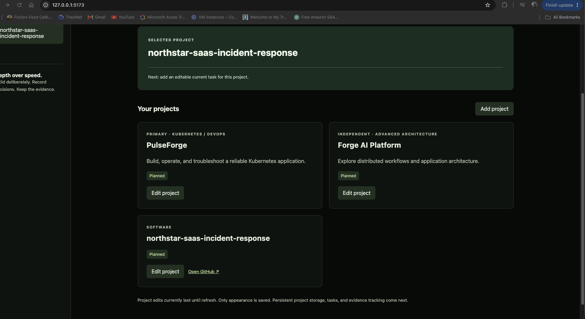

# Cloud Command Center

An in-progress engineering portfolio dashboard built with React,
TypeScript, and Vite inside an Ubuntu lab VM.

## Workspace preview



*Earlier local development screenshot showing project selection,
editable project cards, and a GitHub repository link.*

## Purpose

Organize personal GitHub projects, identify the next task, and
connect technical progress to measurable evidence.

Users can add their own projects. PulseForge and Forge AI Platform
are separate sample workstreams.

## Implemented

- Responsive command center layout and project selection.
- Light, Dark, and System appearance options.
- Appearance preference saved in browser storage.
- Add and edit project names, categories, descriptions, and statuses.
- Validated GitHub repository links.
- Projects saved in browser-local storage.
- One saved current task per project, with status, next step, and notes.
- Workspace export to a versioned JSON backup.
- Backup validation and preview with project and task associations.
- Confirmed restore into empty workspace storage.
- Refusal to restore over existing project or task records.

## Data storage and limitations

Projects, tasks, and appearance preferences are stored locally in
the browser profile for the site address. They do not automatically
sync across devices. Clearing browser storage can remove these records.

Export a backup to keep a separate copy of saved projects and tasks.
Backups exclude appearance preferences and unsaved form edits.
Backup files contain project details and task notes.

Restore requires empty workspace storage. Merging and replacement
of an existing workspace are not supported.

Project and task saving include checks for unreadable stored data
and sequential stale saves. These checks are not a transaction or
a guarantee against simultaneous writes across tabs.

Switching projects discards unsaved task edits.

There are no accounts, shared database, automatic GitHub
synchronization, or live AI mentoring features yet.

## Verification

Manual checks and their limitations are documented here:

- [Project persistence](docs/verification/project-persistence.md)
- [Current tasks](docs/verification/current-task.md)
- [Workspace backup](docs/verification/workspace-backup.md)

Storage write failures, interrupted restores, and simultaneous
writes remain unverified.

## Run locally

Use the Node.js version recorded in `.nvmrc`.

```sh
npm ci
npm run dev
```

For development through a VM network adapter:

```sh
npm run dev -- --host 0.0.0.0 --port 5173 --strictPort
```

## Checks

```sh
npm run lint
npm run build
```

## Next milestone

Prepare the first hosted browser release and verify the shared
application with classmates.

## Planned

Milestones, incident records, ADRs, evidence tracking, and further
operational verification. Desktop packaging is a future goal.

## Project context

Independent portfolio and learning project, built with AI-assisted
guidance. Features are implemented incrementally and are not
represented as professional production experience.
